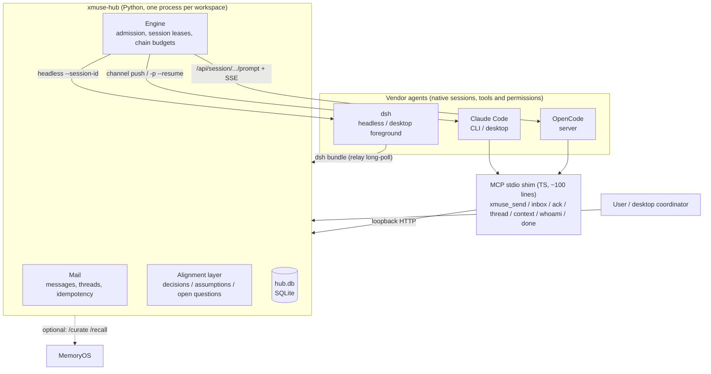

# xmuse 2

> Draft, pending the owner's review. [中文](README.md)

**In one line**: a local, cross-vendor collaboration layer for coding agents. Claude Code, OpenCode and dsh (DeepSeek Harness) agents keep running in their own native environments, and use the same small set of MCP tools to message each other, hand off work and share the conventions they have agreed on. The user coordinates them from one main window.

## The problem

When you use several coding agents at once, they cannot see each other. Hand-offs mean copy-paste, a changed convention reaches nobody, and when one agent waits on another, nobody wakes it up. Most existing answers move the agents into a new platform and lose their native sessions, tools and permission systems.

xmuse does the opposite: **the agents stay as they are, plus a thin plugin**. The plugin gives them an identity, direct and group messages, and shared context. A local hub stores messages, decides when to wake whom, and hands each woken agent the conventions that currently apply.

## Architecture



- **The hub** is about 4,300 lines of Python, adapters included. All state lives in `hub.db`, kept outside the workspace in `~/.local/state/xmuse/<workspace>-<hash>/`.
- **Waking** takes a different path for each vendor:
  - Claude: channel push into an interactive session, or `-p --resume` in the background;
  - OpenCode: its server's prompt API plus SSE;
  - dsh: headless `--session-id` continuation.
  - A recipient runs at most one turn at a time; queued messages merge into that turn.
- **Runaway limits**: each causal chain has a wake cap and a token cap, and each agent has per-hour turn and token caps. When a vendor rate limit hits, messages go back in the queue and the agent pauses until the reset time. `xmuse stop` interrupts at any time.

## Quick start

You need Linux or WSL, [uv](https://docs.astral.sh/uv/), node ≥ 20, and at least one agent CLI (`claude` or `opencode`). dsh runs on Windows only.

```bash
git clone <repo> xmuse2 && cd xmuse2
scripts/bootstrap.sh                     # uv sync + shim npm ci + xmuse doctor; safe to re-run
export PATH="$PWD/hub/.venv/bin:$PATH"

xmuse init ~/work/demo                   # state lives outside the workspace; writes an AGENTS.md section, the skill, .xmuse.json
cd ~/work/demo
xmuse agent add claude-1 --vendor claude
xmuse agent add oc-1 --vendor opencode
xmuse doctor                             # one line per check, with the command that fixes each problem
xmuse hub start

xmuse send claude-1 "implement calc.sub, then hand it to oc-1 for review"   # DM; group: '#topic' with --mention
xmuse log                                # timeline of messages and turns, with tokens
xmuse transcript oc-1                    # an agent's current session as readable text
```

To set up the Claude desktop app as coordinator, dsh foreground mode or the dsh bundle, see [hub/README.md](hub/README.md) and [integrations/dsh-bundle/README.zh.md](integrations/dsh-bundle/README.zh.md).

## Key design points

- **Alignment layer (deterministic, no LLM on the hot path)**
  - Agents declare conventions that others depend on with `kind=decision|assumption|question`. Declarations go straight into the store, and a new convention replaces an old one explicitly with `supersedes`.
  - Each wake carries only the delta the agent has not seen yet, tracked by a watermark. After the vendor compacts a session, the next wake sends a full snapshot again.
  - The wake pack is built by a pipeline of named processors and is byte-identical for equal state, so prefix caches keep hitting.
- **Identity and provenance**
  - Every agent has its own token, and messages record `via`. Words the coordinator relays for the user show as "human (via coordinator)"; messages sent from the CLI show "via cli".
  - A dsh session must `/xmuse bind` to an agent before it can act as that agent.
- **Desktop coordinator**: the Claude desktop app serves as the user's interface. The hub never wakes it in the background, replies addressed to the user are copied to it, and when it relays a decision for the user, the provenance says so.
- **dsh bundle**: registers native `xmuse_*` tools and a `/xmuse` command in dsh desktop, long-polls the hub, and delivers messages into the bound session. The user can watch what dsh is doing and step in at any time.
- **Trust model (stated plainly)**: today this is a **single-user model that guards against mistakes, not against a malicious agent**.
  - Agents run as the same OS user as the hub, so an agent with a shell can read the tokens.
  - "Consequential commands need approval" is a blocklist heuristic, and it can be bypassed (for example `cd x && git push`).
  - Planned fixes are in [audit B2-1/B2-2](docs/design/XMUSE2-AUDIT-2026-10-11.zh.md) and are in progress.

## Results and limits

The [full report](docs/design/XMUSE2-M2B-EXP-REPORT.zh.md) is in Chinese. Setup: OpenCode implements and dsh reviews, on three small cross-module tasks. Groups A (wake everyone), B (wake only mentioned agents) and C (wake only mentioned agents, plus the alignment layer) have 9 runs each; there are also a long-session group and a review group.

**Supported by the data:**
- The alignment layer is cheap: at most 0.4% of a turn's tokens. But the store held only a dozen entries, so this shows low cost, not usefulness.
- In a single turn, the reviewer finds a single planted bug: 6/6 found, with 2 false positives.
- No run needed a human to finish or to fail. The exceptions: one run hung for about 30 minutes on a permission prompt, and one long-session run was stopped by hand.

**Not supported:**
- **"The alignment layer raises completion"**: C 7/9 vs B 6/9 is not significant. The only item that differed comes from an ambiguous spec. With the later runs it is 3/7 vs 0/6 (one-sided p≈0.12), and the task was picked after the fact.
- **"The alignment layer prevents rot"**: every rot message named every agent, everyone followed it, so the test hits a ceiling.
- **"MemoryOS helps"**: an offline replay of 35 runs recovered only 7 checklist items, 70% of its proposals were noise, and its recall ranking was no better than "take the newest".

**Limits:**
- Small samples (3 runs per group per task).
- In the last 21 runs both agents used the same model, so they were cross-framework only.
- No Claude agent took part.
- **No single-agent baseline yet**, so the data cannot say what a team of agents adds over one agent.
- Follow-up experiments (a single-agent baseline, a re-test once the spec is fixed, a review baseline) are planned, with metrics fixed before the runs.

## Layout

| Path | Contents |
|---|---|
| `hub/` | Hub and CLI (`xmuse`), Python; `src/xmuse/adapters/` holds the vendor adapters |
| `shim/` | MCP stdio shim (TS): forwards to the hub and handles Claude channel push |
| `integrations/dsh-bundle/` | dsh desktop plugin bundle (JS) |
| `skill/`, `templates/` | Collaboration skill and AGENTS.md section written into workspaces |
| `tests/` | Hub tests (pytest; fake agents replay real recorded output), about 2–3 minutes |
| `experiments/` | Scenarios, runner, metrics (`metrics.py`), offline replay (`replay_mo.py`), results |
| `docs/design/` | Design notes, experiment report, audit (Chinese) |
| `scripts/bootstrap.sh` | One-step environment setup |
| `spikes/`, `e2e/` | Early probes and end-to-end records (historical; to move under `archive/`) |

## Development

```bash
hub/.venv/bin/python -m pytest tests -q -p no:cacheprovider   # tests that need Windows / dsh skip themselves
(cd integrations/dsh-bundle && npm test)
```

License: to be decided.
