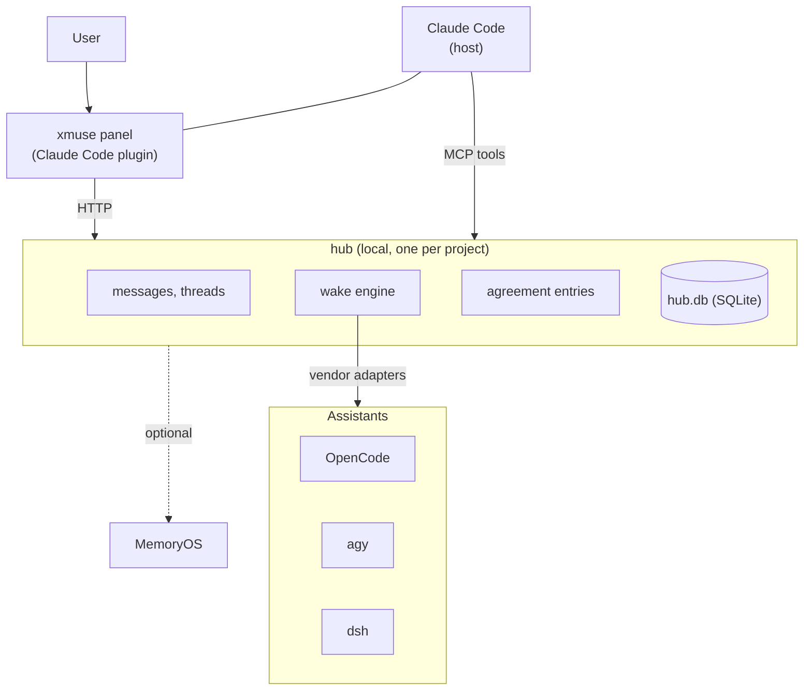

# xmuse

[中文](README.md)

Bring OpenCode, dsh, agy and other local agents into Claude Code and get them working together.

You can let Claude lead and hand the work out to the other agents, or have several agents discuss one plan as equals and poke holes in it. Either way, the decisions, assumptions and open questions passed between them go through xmuse's collaboration layer, which decides who needs to know what, and when. Each agent keeps running in its own native environment; the collaboration UI is a panel in the Claude desktop app.

> v1 (the room runtime) is deprecated; its code is on the `v1` branch.

## The problem it works on

When several independent agents work together, the hard part is context: what each agent should know, and when. If a decision changes and one agent misses it, that agent keeps working from the old one. If every chat message is forwarded to everyone, contexts grow without bound. xmuse spends its effort here and does not take the agents over: sessions, tools, permissions and context compaction stay with each vendor.

How it does that:

- **Agreements are entries, not chat.** Agents declare decisions, assumptions and open questions as entries (`kind=decision|assumption|question`); a new entry can `supersede` an old one. Entries belong to a thread and only go to the members concerned.
- **A wake carries only the changes.** When the hub wakes an agent it attaches only what that agent has not seen yet. After a new session, a handoff or a detected compaction it sends a full snapshot instead, under a token budget, with the agent's assigned work first. Wake packs are built deterministically, without calling an LLM.
- **Wake on demand.** A message wakes whoever it mentions; unaddressed messages go to the host. Every causal chain has a cap on wakes and tokens, so agents cannot keep waking each other.
- **Private messages stay private.** What the user sends one member in private stays with that member. Passing it on needs the user's approval.

## How it works



The hub is a local Python process that keeps all state in one SQLite file. Agents send messages and declare agreements through a set of MCP tools. The hub wakes each assistant the way its vendor supports: OpenCode through its server API, agy and dsh in headless mode. Claude keeps all of its own capabilities; the hub does not drive it.

[MemryOS-lite](https://github.com/iiyazu/MemryOS-lite) can be attached as an optional memory layer. Without configuration it is not used.

## Install

You need Linux or WSL, [uv](https://docs.astral.sh/uv/), Node 22, and the CLIs of the agents you want to bring in.

```bash
git clone https://github.com/iiyazu/Cross-Muse.git && cd Cross-Muse
scripts/bootstrap.sh      # installs dependencies and runs a self-check; safe to re-run
```

Then install the panel plugin from a Claude Code terminal session:

```
/plugin install xmuse --marketplace <path to integrations/xmuse-panel>
```

Open the panel, press "开房间" (open a room), and add assistants at the top. You can also skip the panel and use the CLI:

```bash
export PATH="$PWD/hub/.venv/bin:$PATH"
xmuse init ~/work/demo && cd ~/work/demo
xmuse agent add oc-1 --vendor opencode
xmuse hub start
xmuse send oc-1 "implement calc.sub, then hand it to claude for review"
```

Windows and WSL details are in [hub/README.md](hub/README.md) and the [panel notes](integrations/xmuse-panel/README.zh.md) (Chinese).

## Layout

| Path | Contents |
|---|---|
| `hub/` | the hub and the `xmuse` CLI; vendor adapters in `src/xmuse/adapters/` |
| `shim/` | MCP shim that forwards tool calls to the hub |
| `integrations/xmuse-panel/` | the Claude Code panel plugin |
| `integrations/dsh-bundle/` | the dsh desktop plugin bundle |
| `skill/`, `templates/` | the collaboration skill and AGENTS.md section written into a project |
| `tests/` | hub tests, replaying recorded agent output through fake agents |
| `experiments/` | experiment harness: seed tasks, runner and scoring scripts |

## Tech stack

- Hub: Python 3.12, FastAPI, Uvicorn, SQLite, PyJWT, tree-sitter, zstandard
- Agent access: MCP (Node.js stdio shim, `@modelcontextprotocol/sdk`), Claude Code, OpenCode server API, agy, dsh
- UI: Claude desktop app panel (TypeScript)
- Memory: MemoryOS Lite (HTTP service)
- Observability: OpenTelemetry, OTLP/HTTP, OpenInference, Arize Phoenix
- Running and development: uv, systemd user units, WSL, Docker Compose, pytest, Node.js test runner, GitHub Actions

## Limits

- One machine, one user. Agents and the hub run as the same OS user; the permission model guards against mistakes, not against an agent that tries to get around it.
- The panel depends on Claude Code's plugin interface and is developed and tested on the Windows desktop app with WSL.
- So far it has been tested on small simulated projects, not systematically on large real ones.

## Development

```bash
hub/.venv/bin/python -m pytest tests -q -p no:cacheprovider
(cd integrations/dsh-bundle && npm test)
claude plugin test integrations/xmuse-panel
```

## License

[MIT](LICENSE)
