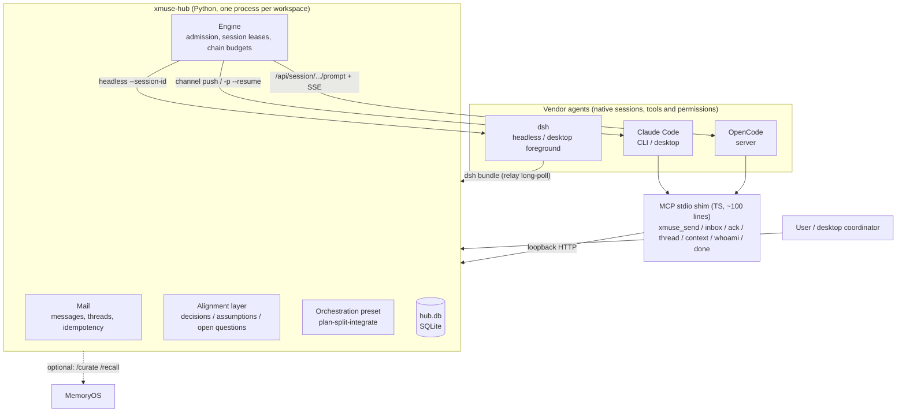

# xmuse 2

[中文](README.md)

**In one line**: a local, cross-vendor collaboration layer for coding agents. Claude Code, OpenCode and dsh (DeepSeek Harness) agents keep running in their own native environments, and use the same small set of MCP tools to message each other, hand off work and share the conventions they have agreed on. The user coordinates them from one main window.

## The problem

When you use several coding agents at once, they cannot see each other. Hand-offs mean copy-paste, a changed convention reaches nobody, and when one agent waits on another, nobody wakes it up. Most existing answers move the agents into a new platform and lose their native sessions, tools and permission systems.

xmuse does the opposite: **the agents stay as they are, plus a thin plugin**. The plugin gives them an identity, direct and group messages, and shared context. A local hub stores messages, decides when to wake whom, and hands each woken agent the conventions that currently apply.

## Architecture



- **The hub** is about 5,500 lines of Python, adapters and the orchestration preset included. All state lives in `hub.db`, kept outside the workspace in `~/.local/state/xmuse/<workspace>-<hash>/`.
- **Waking** takes a different path for each vendor:
  - Claude: channel push into an interactive session, or `-p --resume` in the background;
  - OpenCode: its server's prompt API plus SSE;
  - dsh: headless `--session-id` continuation.
  - A recipient runs at most one turn at a time; queued messages merge into that turn.
- **Runaway limits**: each causal chain has a wake cap and a token cap, and each agent has per-hour turn and token caps. When a vendor rate limit hits, messages go back in the queue and the agent pauses until the reset time. `xmuse stop` interrupts at any time.

## Quick start

You need Linux or WSL, [uv](https://docs.astral.sh/uv/), node ≥ 20, and at least one agent CLI (`claude` or `opencode`). dsh runs on Windows only.

```bash
git clone <repo> xmuse2 && cd xmuse2
scripts/bootstrap.sh                     # uv sync + shim npm ci + xmuse doctor; safe to re-run
export PATH="$PWD/hub/.venv/bin:$PATH"

xmuse init ~/work/demo                   # state lives outside the workspace; writes an AGENTS.md section, the skill, .xmuse.json
cd ~/work/demo
xmuse agent add claude-1 --vendor claude
xmuse agent add oc-1 --vendor opencode
xmuse doctor                             # one line per check, with the command that fixes each problem
xmuse hub start

xmuse send claude-1 "implement calc.sub, then hand it to oc-1 for review"   # DM; group: '#topic' with --mention
xmuse log                                # timeline of messages and turns, with tokens
xmuse transcript oc-1                    # an agent's current session as readable text
```

To set up the Claude desktop app as coordinator, dsh foreground mode or the dsh bundle, see [hub/README.md](hub/README.md) and [integrations/dsh-bundle/README.zh.md](integrations/dsh-bundle/README.zh.md).

## Key design points

- **Alignment layer (deterministic, no LLM on the hot path)**
  - Agents declare conventions that others depend on with `kind=decision|assumption|question`. Declarations go straight into the store, and a new convention replaces an old one explicitly with `supersedes`.
  - Each wake carries only the delta the agent has not seen yet, tracked by a watermark. After the vendor compacts a session, the next wake sends a full snapshot again.
  - The wake pack is built by a pipeline of named processors and is byte-identical for equal state, so prefix caches keep hitting.
  - **Module scope**: an entry can carry `module:<name>` and is injected only into agents subscribed to that module, plus the entry's author. Subscriptions come from the modules named in a handoff: both the assignee and the assigner (the planner) subscribe.
  - **Dependency wake**: a handoff with `depends_on` does not wake the executor while the dependency is unresolved; once it resolves (a reply, a confirmation, a closed thread) the executor is woken.
  - **Question routing**: a question wakes the planner without needing a mention; the planner's answer propagates in the original scope and wakes the asker.
- **Info-layer master switch**: the hub setting `info_layer` (in `config.json` in the state directory, default `on`). With `off`, only plain messages remain: `kind` in the tool table is just `message`, there is no `xmuse_context`, the prompts no longer mention decisions and the like, and the hub rejects every other kind. Nothing is injected, there is no scope or question routing or dependency wake, and agents are woken by mentions only. It exists for controlled comparisons: same agents, same topology, only this switch differs.
- **Several instances per vendor**: each OpenCode agent gets its own server (own port, password and config file); headless dsh passes its identity per run, so several can be registered. Claude stays at one, because `.mcp.json` can hold only one identity.
- **Orchestration preset plan-split-integrate**: one planner plus several executors, driven by a state machine in the hub.
  - Phases: P0 planning (the planner writes `.xmuse-plan.json`: file ownership and an acceptance list) → P1 executors in parallel → P2 integration → P3 targeted fixes (2 rounds at most by default) → wrap-up. Every phase has a time limit and is forced forward on timeout; the default total limit is 3600 seconds.
  - Each executor has its own git worktree and branch under `<workspace>/.xmuse-wt/<id>`; a snapshot (a `git diff --binary` patch) is saved at the end of each phase.
  - A crashed agent is retried once, then degraded and taken over by another executor. A branch that conflicts on merge is left to the planner and logged as an event; edits outside an executor's files are logged, not blocked.
  - Usage: `xmuse run --preset plan-split-integrate --planner P --executors E1,E2 --task-file F [--limits JSON]`; progress with `xmuse run-status [id]`.
  - So far the whole flow has been tested only with scripted fake agents, not yet run end to end with real ones.
- **Extra MCP servers for headless dsh and OpenCode**: `xmuse agent add <id> --vendor dsh|opencode --extra-mcp file.json` mounts additional stdio MCP servers (`[{name, command, args, env}]`) for that agent, for example a tool that can only run tests in the experiments.
  - dsh: written into the overlay of every run.
  - OpenCode: written into that instance's own config, plus an allow rule in the workspace permissions for the tools under those server names (`<name>_*`).
- **Identity and provenance**
  - Every agent has its own token, and messages record `via`. Words the coordinator relays for the user show as "human (via coordinator)"; messages sent from the CLI show "via cli".
  - A dsh session must `/xmuse bind` to an agent before it can act as that agent.
- **Desktop coordinator**: the Claude desktop app serves as the user's interface. The hub never wakes it in the background, replies addressed to the user are copied to it, and when it relays a decision for the user, the provenance says so.
- **dsh bundle**: registers native `xmuse_*` tools and a `/xmuse` command in dsh desktop, long-polls the hub, and delivers messages into the bound session. The user can watch what dsh is doing and step in at any time.
- **Trust model (stated plainly)**: this is a **single-user model that guards against mistakes, not against an agent that sets out to get around it**.
  - Every OpenCode shell command goes to the hub first. The hub approves on its own only single commands on an allowlist (tests, read-only inspection, local git, and so on); chained commands, `bash -c`, `python -c` and everything else go to the human.
  - Three admin actions need more than the admin token: approving a held command, confirming a proposal, and resuming a paused agent. The call must come from the user's own terminal (a process with a controlling terminal, outside every agent's process tree), or from the desktop coordinator relaying the user's own words.
  - Remaining gap: agents run as the same OS user as the hub, so they can still read the token files, and a determined agent can fool the process check. A real boundary needs a separate OS user or a sandbox for agents; see [design §4.7](docs/design/XMUSE2-ARCH-2026-10.zh.md).

## Results and limits

### M2b: alignment-layer comparison

The [full report](docs/design/XMUSE2-M2B-EXP-REPORT.zh.md) is in Chinese. Setup: OpenCode implements and dsh reviews, on three small cross-module tasks. Groups A (wake everyone), B (wake only mentioned agents) and C (wake only mentioned agents, plus the alignment layer) have 9 runs each; there are also a long-session group and a review group.

**Supported by the data:**
- The alignment layer is cheap: at most 0.4% of a turn's tokens. But the store held only a dozen entries, so this shows low cost, not usefulness.
- In a single turn, the reviewer finds a single planted bug: 6/6 found, with 2 false positives.
- No run needed a human to finish or to fail. The exceptions: one run hung for about 30 minutes on a permission prompt, and one long-session run was stopped by hand.

**Not supported:**
- **"The alignment layer raises completion"**: C 7/9 vs B 6/9 is not significant. The only item that differed comes from an ambiguous spec. With the later runs it is 3/7 vs 0/6 (one-sided p≈0.12), and the task was picked after the fact.
- **"The alignment layer prevents rot"**: every rot message named every agent, everyone followed it, so the test hits a ceiling.
- **"MemoryOS helps"**: an offline replay of 35 runs recovered only 7 checklist items, 70% of its proposals were noise, and its recall ranking was no better than "take the newest".

**Limits:**
- Small samples (3 runs per group per task).
- In the last 21 runs both agents used the same model, so they were cross-framework only.
- No Claude agent took part.

### T6: single-agent baseline and follow-ups

[Pre-registration and results](docs/design/XMUSE2-T6-PREREG.zh.md) (in Chinese): metrics fixed before the runs, 42 runs in total. Same tasks, but the two ambiguities in the spec (the two "guess the answer" failures in M2b) are now written down.

| Comparison | Result | 95% CI of the difference |
|---|---|---|
| Single agent (implement plus self-review) vs multi-agent (OpenCode implements, dsh reviews), completion rate | 9/9 vs 9/9 | −0.30 to +0.30 |
| Alignment layer C2 vs B2 (minisql), completion rate | 6/6 vs 5/6 | −0.25 to +0.56 |
| Same-vendor vs cross-vendor review, planted-bug detection | 6/6 vs 6/6 | −0.39 to +0.39 |

- On small tasks the single agent and the multi-agent team score the same, and every interval spans 0. **The team shows no advantage and costs more**: a single-agent run averages about 830k tokens in 2 turns; the team about 4.1M tokens in 8 turns, so the single agent uses about a fifth.
- Completion and detection rates hit the ceiling, so these tasks cannot tell the arms apart. Only cost differs.
- With the spec fixed, the gap between alignment layer C and B shrinks to one run. That matches M2b's reading that the difference came from the ambiguity, and it does not show that the alignment layer helps.
- Confounds: base and r7 (two machines) each ran part of the runs, with different hub commits and OpenCode versions; dsh used `deepseek-v4-flash` in T6 and muse-spark in M2b, so the two batches cannot be pooled.

### T15: team experiment on a bug-hunt codebase (in progress)

A small task cannot show the value of collaboration, so the next test is larger: a bug-hunt built on a private Spring Boot project, 44 bugs spread across layers, some of them cross-layer (the dataset is not public).
- **Single agent**: one dsh agent fixed 32/44 in 7 minutes with no regressions. It never called the test tool and worked from reading the code alone. The set is too easy and its difficulty is being adjusted; if it is not, the team experiment runs on the current set.
- **Team experiment**: [pre-registered](docs/design/T15-TEAM-PREREG.zh.md) (in Chinese) and **not yet run**. Three agents (one planner, two executors, from two shells and two models) use the preset above. The two groups share topology, task text, time limits and guardrails and differ only in the info-layer switch (`info_layer` on vs off), with 3 runs each, alternating. The primary metric is collaboration quality: duplicate fixes, fixes lost in integration, merge conflicts, inconsistent edits on the two sides of a cross-layer bug, and tokens. With 3 runs per group the results are descriptive only, with no significance claims.

Where this leaves us: **there is no data yet that the info layer helps**, and on small tasks the team did no better than one agent. T15 asks whether that changes on a larger task where several agents must edit one system in parallel.

## Layout

| Path | Contents |
|---|---|
| `hub/` | Hub and CLI (`xmuse`), Python; `src/xmuse/adapters/` holds the vendor adapters |
| `shim/` | MCP stdio shim (TS): forwards to the hub and handles Claude channel push |
| `integrations/dsh-bundle/` | dsh desktop plugin bundle (JS) |
| `skill/`, `templates/` | Collaboration skill and AGENTS.md section written into workspaces |
| `tests/` | Hub tests (pytest; fake agents replay real recorded output), about 3 minutes |
| `experiments/` | Scenarios, runner, metrics (`metrics.py`), offline replay (`replay_mo.py`), results |
| `docs/design/` | Design notes, pre-registrations, experiment report, audit (Chinese) |
| `docs/HANDOFF-BASE-REPORT.zh.md` | Per-task reports: what was done, raw test output, what was left open (Chinese) |
| `scripts/bootstrap.sh` | One-step environment setup |
| `archive/` | Early probes (`spikes/`) and M1 end-to-end records (`e2e/`), kept for history, not maintained |

## Development

```bash
hub/.venv/bin/python -m pytest tests -q -p no:cacheprovider   # tests that need Windows / dsh skip themselves
(cd integrations/dsh-bundle && npm test)
```

Last measured: hub 337 passed, 1 skipped, in about 2 min 28 s; bundle 28 passed.

## License

[MIT](LICENSE).
