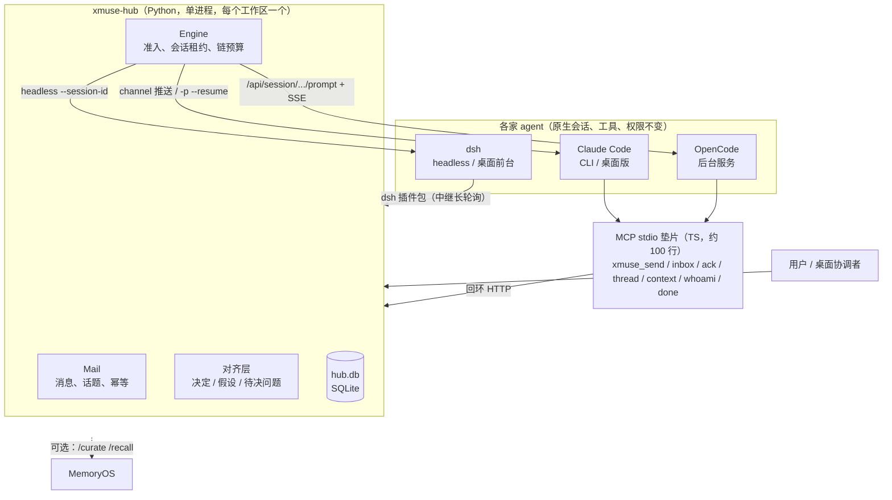

# xmuse 2

> 草稿，等用户审阅后定稿。[English](README.en.md)

**一句话**：一个本地的跨厂商 agent 协作层。Claude Code、OpenCode、dsh（DeepSeek Harness）的 agent 各自在原生环境里运行，通过同一组 MCP 工具互相发消息、交接任务、共享已经定下的约定。用户在一个主窗口里协调它们。

## 解决什么问题

同时用几家 coding agent 时，它们彼此看不到对方：交接靠人复制粘贴，约定改了没人通知，一方在等另一方时也没人去叫醒。现成方案大多把 agent 装进一个新平台，原生的会话、工具和权限就丢了。

xmuse 反过来做：**agent 不动，只加一个很薄的插件**。插件提供身份、私聊和群聊、协作上下文；一个本地 hub 负责持久化消息、决定什么时候叫醒谁、在唤醒时带上当前有效的约定。

## 架构



- **hub** 大约 4,300 行 Python（含适配器）。所有状态都在 `hub.db`，放在工作区外的 `~/.local/state/xmuse/<工作区>-<hash>/`。
- **唤醒**按厂商各走一条路：
  - Claude：交互会话走 channel 推送，后台走 `-p --resume`；
  - OpenCode：用它后台服务的 prompt API 加 SSE；
  - dsh：用 headless `--session-id` 续接。
  - 一个收件人同时只跑一个回合，排队的消息合并进同一个回合。
- **防失控**：每条因果链有唤醒次数和 token 上限，每个 agent 每小时有回合和 token 上限；碰到厂商限额时消息重新排队，agent 暂停到重置时刻；`xmuse stop` 可以随时中断。

## 快速开始

需要：Linux 或 WSL、[uv](https://docs.astral.sh/uv/)、node ≥ 20，以及至少一家 agent 的 CLI（`claude` 或 `opencode`）。dsh 只有 Windows 版。

```bash
git clone <repo> xmuse2 && cd xmuse2
scripts/bootstrap.sh                     # uv sync + 垫片 npm ci + xmuse doctor，可以重复执行
export PATH="$PWD/hub/.venv/bin:$PATH"

xmuse init ~/work/demo                   # 状态放在工作区外；生成 AGENTS.md 段落、技能和 .xmuse.json
cd ~/work/demo
xmuse agent add claude-1 --vendor claude
xmuse agent add oc-1 --vendor opencode
xmuse doctor                             # 逐项检查，每个问题都给出修复命令
xmuse hub start

xmuse send claude-1 "实现 calc.sub，写完交给 oc-1 复核"   # 私聊；群聊用 '#话题名' 加 --mention
xmuse log                                # 消息和回合（含 token）的时间线
xmuse transcript oc-1                    # 某个 agent 当前会话的可读文本
```

Claude 桌面版当协调者、dsh 前台模式和插件包的配置，见 [hub/README.md](hub/README.md) 和 [integrations/dsh-bundle/README.zh.md](integrations/dsh-bundle/README.zh.md)。

## 关键设计

- **对齐层（确定性，热路径不调用 LLM）**
  - agent 用 `kind=decision|assumption|question` 申报会影响别人的约定，申报直接入库；新约定通过 `supersedes` 显式替换旧的。
  - 每次唤醒按"水位"只注入对方还没看过的差量；会话被压缩后，下一次唤醒重发完整快照。
  - 唤醒包由一串有名字的处理器生成，状态相同时输出逐字节相同，方便命中前缀缓存。
- **身份和来源**
  - 每个 agent 有自己的令牌；消息记录 `via`。协调者代用户转达的话记为"用户（经协调者）"，CLI 发出的记为"via cli"。
  - dsh 会话要先 `/xmuse bind` 才能以某个 agent 的身份行事。
- **桌面协调者**：Claude 桌面版作为用户界面。hub 从不在后台唤醒它；发给用户的消息会抄送给它；它可以代用户转达决定，来源会标明。
- **dsh 插件包**：在 dsh 桌面端注册原生的 `xmuse_*` 工具和 `/xmuse` 命令，长轮询 hub，把消息投进已绑定的会话。用户可以直接看到 dsh 在做什么，也可以随时插话。
- **信任模型（如实说明）**：目前是**防误操作的单用户模型，不防恶意 agent**。
  - agent 和 hub 以同一个 OS 用户运行，有 shell 的 agent 能读到令牌；
  - "有后果的命令要人批"是黑名单启发式，可以绕过（例如 `cd x && git push`）。
  - 改进方案在 [审计 B2-1/B2-2](docs/design/XMUSE2-AUDIT-2026-10-11.zh.md)，正在做。

## 实验结果摘要和局限

[完整报告](docs/design/XMUSE2-M2B-EXP-REPORT.zh.md)：OpenCode 实现、dsh 复核，三个跨模块小任务，A（全员唤醒）、B（点名唤醒）、C（点名唤醒加对齐层）各 9 个 run，另有长会话组和复核组。

数据**支持**的结论：
- 对齐层很便宜：每回合注入占比最高 0.4%。但对齐库只有十几条，这只说明成本低。
- 复核方能在单回合里找到预埋的单个 bug：6/6 检出，2 条误报。
- 所有 run 在完成或失败时都不需要人插手。例外是 1 个 run 挂在权限确认上约 30 分钟，1 个长会话 run 被人工停掉。

数据**不支持**的结论：
- **"对齐层提高完成率"**：C 组 7/9 对 B 组 6/9，差异不显著。唯一有差别的一项来自 SPEC 里没写清楚的边界；补上后续 run 后是 3/7 对 0/6，单侧 p≈0.12，而且有事后挑选的问题。
- **"对齐层防 rot"**：rot 消息点名了每个人，全部遵守，存在天花板效应。
- **MemoryOS 有用**：离线回放 35 个 run，只补出 7 个清单项；70% 的提议是噪音；召回排序和"取最新"没有差别。

局限：
- 样本小（每组每个任务 3 次）；
- 后 21 个 run 里两边是同一个模型，只算"跨框架"；
- 没有 Claude 参与；
- **还没有单 agent 基线**，回答不了"比一个 agent 自己做强在哪"。
- 补充实验（单 agent 基线、修好 SPEC 后重测、复核基线）已列入计划，会先定好指标再跑。

## 目录结构

| 路径 | 内容 |
|---|---|
| `hub/` | hub 和 CLI（`xmuse`），Python；`src/xmuse/adapters/` 是各厂商适配器 |
| `shim/` | MCP stdio 垫片（TS），转发到 hub，负责 Claude channel 推送 |
| `integrations/dsh-bundle/` | dsh 桌面端插件包（JS） |
| `skill/`、`templates/` | 写进工作区的协作技能和 AGENTS.md 段落 |
| `tests/` | hub 测试（pytest，假 agent 回放真实录制的输出），约 2–3 分钟 |
| `experiments/` | 实验场景、runner、指标（`metrics.py`）、离线回放（`replay_mo.py`）、结果 |
| `docs/design/` | 设计稿、实验报告、审计 |
| `scripts/bootstrap.sh` | 一键准备环境 |
| `spikes/`、`e2e/` | 早期探针和端到端记录（历史产物，计划移到 `archive/`） |

## 开发

```bash
hub/.venv/bin/python -m pytest tests -q -p no:cacheprovider   # 依赖 Windows / dsh 的测试会自动跳过
(cd integrations/dsh-bundle && npm test)
```

许可证：待定。
