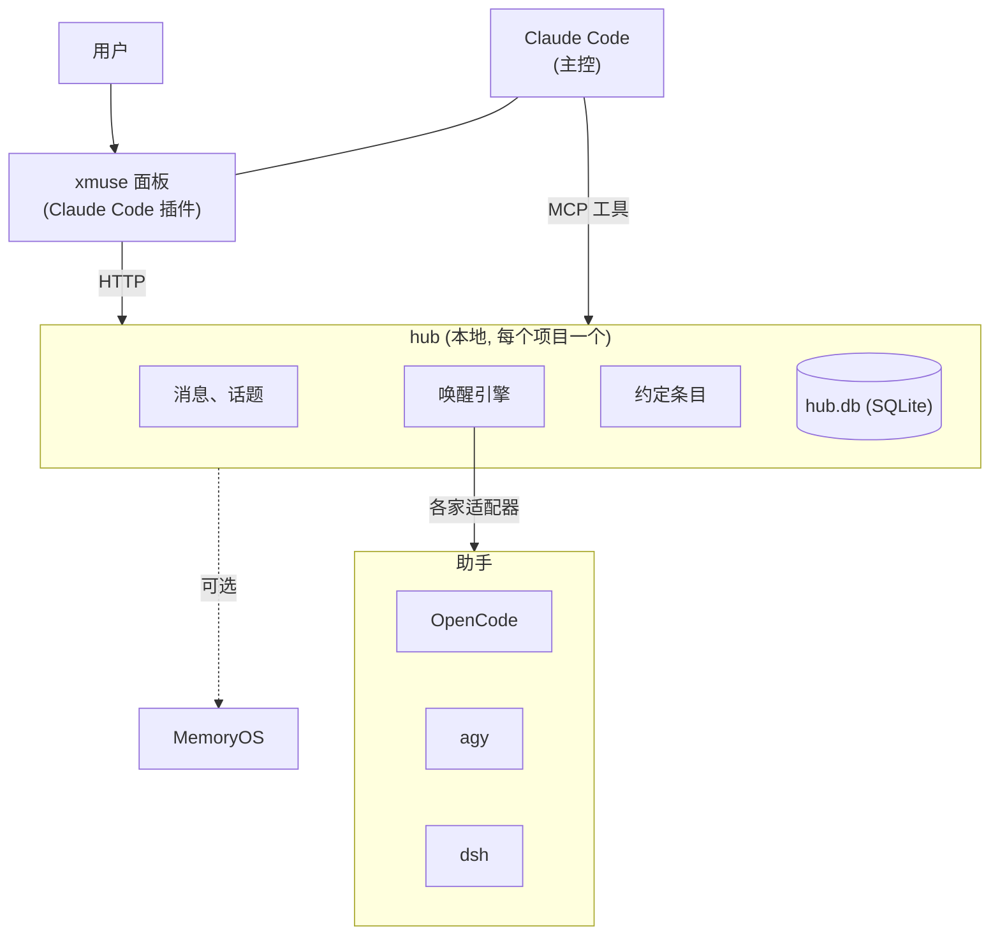

# xmuse

[English](README.en.md)

在 Claude Code 里聚合 OpenCode、dsh、agy 等本地 agent，一起干活。

你可以让 Claude 当主控，把活派给其他 agent 去干；也可以让几个 agent 平等地讨论同一个方案，互相挑毛病。不管哪种方式，agent 之间的决定、假设和待决问题都由 xmuse 的信息协作层管理：谁该知道什么、什么时候知道。每个 agent 仍在自己原生的环境里运行，协作界面是 Claude 桌面 App 里的一个面板。

> v1（房间运行时）已废弃，代码留在 `v1` 分支。

## 关注的问题

几个独立的 agent 一起干活时，难点在上下文：每个 agent 该知道什么、什么时候知道。约定改了，没收到的那个会照旧干；全量转发聊天记录，上下文又会越涨越长。xmuse 把精力放在这件事上，而不去接管 agent 本身：会话、工具、权限、上下文压缩，都由各家自己管。

具体做法：

- **约定是条目，不是聊天。** agent 把决定、假设、待决问题作为条目申报（`kind=decision|assumption|question`），新条目可以用 `supersedes` 取代旧的。条目按话题归属，只发给相关的成员。
- **唤醒时只带差量。** hub 叫醒一个 agent 时，只附上它还没见过的变化；新会话、交接或检测到上下文被压缩后，改发一份有预算上限的完整快照，分配给它的工作排在最前面。唤醒包的生成是确定性的，不调用 LLM。
- **按需唤醒。** 消息点名谁就叫醒谁，没点名的交给主控。每条因果链有唤醒次数和 token 上限，防止 agent 互相叫醒打转。
- **私信默认不外传。** 用户私下发给某个成员的内容只留在它那里。成员想转给别人时，要经用户批准。

## 怎么工作



hub 是一个本地 Python 进程，所有状态存在一个 SQLite 文件里。agent 通过一组 MCP 工具收发消息、申报约定。助手由 hub 按各家的方式叫醒：OpenCode 走它的后台服务接口，agy 和 dsh 走无界面模式。Claude 保留自己的全部能力，hub 不驱动它。

[MemryOS-lite](https://github.com/iiyazu/MemryOS-lite) 可以作为可选的记忆层接入，不配置就不用。

## 安装

需要 Linux 或 WSL、[uv](https://docs.astral.sh/uv/)、Node 22，以及要接入的 agent 的 CLI。

```bash
git clone https://github.com/iiyazu/Cross-Muse.git && cd Cross-Muse
scripts/bootstrap.sh      # 安装依赖并自检，可重复执行
```

然后在 Claude Code 的终端会话里安装面板插件：

```
/plugin install xmuse --marketplace <integrations/xmuse-panel 的路径>
```

打开面板，点"开房间"，再在顶部添加助手。也可以不用面板，直接用命令行：

```bash
export PATH="$PWD/hub/.venv/bin:$PATH"
xmuse init ~/work/demo && cd ~/work/demo
xmuse agent add oc-1 --vendor opencode
xmuse hub start
xmuse send oc-1 "实现 calc.sub，写完交给 claude 复核"
```

Windows 加 WSL 的细节见 [hub/README.md](hub/README.md) 和 [面板说明](integrations/xmuse-panel/README.zh.md)。

## 目录

| 路径 | 内容 |
|---|---|
| `hub/` | hub 和命令行 `xmuse`；`src/xmuse/adapters/` 是各家适配器 |
| `shim/` | MCP 垫片，把工具调用转给 hub |
| `integrations/xmuse-panel/` | Claude Code 面板插件 |
| `integrations/dsh-bundle/` | dsh 桌面端插件包 |
| `skill/`、`templates/` | 写进项目的协作技能和 AGENTS.md 段落 |
| `tests/` | hub 测试，用假 agent 回放录制的输出 |
| `experiments/`、`docs/design/` | 实验、设计稿和报告 |

## 验证

用机制探针验证：在一个小的模拟项目里每次只测一项功能，结果由程序判定，每格 10 次。

- **约定变更能送达。** 用户只私信一个成员改了分工。不经 hub 时，另一个成员 10 次里 10 次没同步，成员主动转告只有 1 次，那一次对方也没改过来；经 hub 时 10 次都同步（单侧 Fisher 检验，p=0.006）。在变更发生的那几轮里，经 hub 的组只唤醒 1 次，token 比全员广播少约 46%。
- **约定条目比普通消息更会被照做。** 同一条格式规则，作为普通消息发出时，40 个成员里有 9 个认为它不是团队规则、不遵守；作为约定条目发出时，20 个成员里没有一个违反（p=0.019）。
- **约定的开销很小。** 在多 agent 编码实验里，约定部分占每次唤醒 token 的比例最高 0.4%。

数据和效度讨论见 [HANDOFF-BASE-REPORT.zh.md](docs/HANDOFF-BASE-REPORT.zh.md) 的"S 系列阶段分析"一节和 [M2b 实验报告](docs/design/XMUSE2-M2B-EXP-REPORT.zh.md)，探针设计见 [XMUSE2-PROBES.zh.md](docs/design/XMUSE2-PROBES.zh.md)。

## 观测

hub.db 是唯一的事实来源；`hub/src/xmuse/otel.py` 把终态行（回合、消息、审批、被拦的链）派生成标准 OpenTelemetry trace，交给现成的 LLM 观测后端展示。默认关闭，打开也不影响 hub 行为：导出失败只记一条警告，下次 kick 重试（`otel_marks` 去重，至少一次）。

```bash
# 1. 起默认后端（Phoenix，单容器）：http://localhost:6006
docker compose -f scripts/otel/docker-compose.yml up -d
# 2. 装导出依赖
uv sync --project hub --group otel
# 3. 在 hub 配置里打开（config.json 顶层加 "otel": {"enabled": true}），或临时 XMUSE_OTEL_ENABLED=1
```

`xmuse doctor` 会检查依赖和端点可达性（headers 可能含后端密钥，从不打印）。`xmuse trace export --state <dir|hub.db> [--endpoint URL] [--since TS] [--room-id ID]` 把任意一份 hub.db（例如实验的 `runs/*/hub.db`）事后回放进后端，只读不写；实验 run 没有房间，用 `--room-id <run 名>` 区分，否则不同 run 的 trace id 会撞在一起。`scripts/otel/check_replay.py` 从 Phoenix 的 REST 接口读回 span，和 hub.db 逐行对账。属性为锁定的 semconv（`opentelemetry-semantic-conventions==0.66b1`，Development）加 `openinference.span.kind`；消息正文默认不导出（`capture_content` 打开后用户私信仍需 share 标记）。详见 [XMUSE2-OTEL.zh.md](docs/design/XMUSE2-OTEL.zh.md)。

## 局限

- 单机、单用户。agent 和 hub 以同一个系统用户运行，权限模型只防误操作，不防有意绕过的 agent。
- 面板依赖 Claude Code 的插件接口，目前按 Windows 桌面 App 加 WSL 的组合开发和测试。
- 验证用的是小规模模拟项目，还没有在大型真实项目里系统地测过。

## 开发

```bash
hub/.venv/bin/python -m pytest tests -q -p no:cacheprovider
(cd integrations/dsh-bundle && npm test)
claude plugin test integrations/xmuse-panel
```

## 许可证

[MIT](LICENSE)
