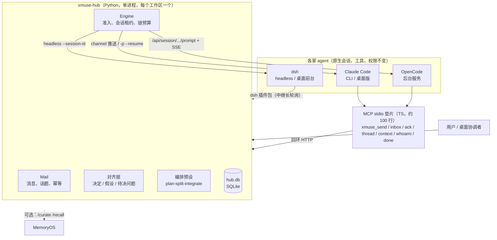

# xmuse 2

[English](README.en.md)

**一句话**：一个本地的跨厂商 agent 协作层。Claude Code、OpenCode、dsh（DeepSeek Harness）的 agent 各自在原生环境里运行，通过同一组 MCP 工具互相发消息、交接任务、共享已经定下的约定。用户在一个主窗口里协调它们。

## 解决什么问题

同时用几家 coding agent 时，它们彼此看不到对方：交接靠人复制粘贴，约定改了没人通知，一方在等另一方时也没人去叫醒。现成方案大多把 agent 装进一个新平台，原生的会话、工具和权限就丢了。

xmuse 反过来做：**agent 不动，只加一个很薄的插件**。插件提供身份、私聊和群聊、协作上下文；一个本地 hub 负责持久化消息、决定什么时候叫醒谁、在唤醒时带上当前有效的约定。

## 架构



- **hub** 大约 5,500 行 Python（含适配器和编排预设）。所有状态都在 `hub.db`，放在工作区外的 `~/.local/state/xmuse/<工作区>-<hash>/`。
- **唤醒**按厂商各走一条路：
  - Claude：交互会话走 channel 推送，后台走 `-p --resume`；
  - OpenCode：用它后台服务的 prompt API 加 SSE；
  - dsh：用 headless `--session-id` 续接。
  - 一个收件人同时只跑一个回合，排队的消息合并进同一个回合。
- **防失控**：每条因果链有唤醒次数和 token 上限，每个 agent 每小时有回合和 token 上限；碰到厂商限额时消息重新排队，agent 暂停到重置时刻；`xmuse stop` 可以随时中断。

## 快速开始

需要：Linux 或 WSL、[uv](https://docs.astral.sh/uv/)、node ≥ 20，以及至少一家 agent 的 CLI（`claude` 或 `opencode`）。dsh 只有 Windows 版。

```bash
git clone <repo> xmuse2 && cd xmuse2
scripts/bootstrap.sh                     # uv sync + 垫片 npm ci + xmuse doctor，可以重复执行
export PATH="$PWD/hub/.venv/bin:$PATH"

xmuse init ~/work/demo                   # 状态放在工作区外；生成 AGENTS.md 段落、技能和 .xmuse.json
cd ~/work/demo
xmuse agent add claude-1 --vendor claude
xmuse agent add oc-1 --vendor opencode
xmuse doctor                             # 逐项检查，每个问题都给出修复命令
xmuse hub start

xmuse send claude-1 "实现 calc.sub，写完交给 oc-1 复核"   # 私聊；群聊用 '#话题名' 加 --mention
xmuse log                                # 消息和回合（含 token）的时间线
xmuse transcript oc-1                    # 某个 agent 当前会话的可读文本
```

Claude 桌面版当协调者、dsh 前台模式和插件包的配置，见 [hub/README.md](hub/README.md) 和 [integrations/dsh-bundle/README.zh.md](integrations/dsh-bundle/README.zh.md)。

## 关键设计

- **对齐层（确定性，热路径不调用 LLM）**
  - agent 用 `kind=decision|assumption|question` 申报会影响别人的约定，申报直接入库；新约定通过 `supersedes` 显式替换旧的。
  - 每次唤醒按"水位"只注入对方还没看过的差量；会话被压缩后，下一次唤醒重发完整快照。
  - 唤醒包由一串有名字的处理器生成，状态相同时输出逐字节相同，方便命中前缀缓存。
  - **模块作用域**：条目可以带 `module:<名字>`，只注入给订阅了该模块的 agent，外加条目的作者。订阅来自 handoff 里写明的模块：assignment 的接收者和下发者（规划者）都订阅。
  - **依赖唤醒**：handoff 带 `depends_on` 且依赖未解决时，不唤醒执行者；依赖一解决（回复、确认、关闭线程）就唤醒。
  - **问题路由**：question 会唤醒规划者（不用点名），规划者的答复沿用原来的作用域传播，并唤醒提问者。
- **信息层总开关**：hub 配置项 `info_layer`（写在状态目录的 `config.json`，默认 `on`）。设为 `off` 后只剩普通消息：工具表里 `kind` 只有 `message`，没有 `xmuse_context`，提示词里不再提 decision 等概念，hub 也拒绝其他 kind，不注入、不按作用域和问题路由、不做依赖唤醒，只按点名唤醒。用于对照实验：同一批 agent、同一拓扑，只差这个开关。
- **同一厂商多个实例**：OpenCode 每个 agent 一个独立的服务（单独端口、密码、配置文件）；dsh 无界面模式的身份按次传入，可以注册多个。Claude 仍限一个，因为 `.mcp.json` 只能写一个身份。
- **编排预设 plan-split-integrate**：一个规划者加若干执行者，由 hub 推进的状态机。
  - 阶段：P0 规划（规划者写 `.xmuse-plan.json`：文件归属和验收清单）→ P1 执行者并行 → P2 集成 → P3 定向修复（默认最多 2 轮）→ 收尾。每个阶段有时限，超时就强制推进；总时限默认 3600 秒。
  - 每个执行者在 `<工作区>/.xmuse-wt/<id>` 有自己的 git worktree 和分支；各阶段结束时存快照（`git diff --binary` 补丁）。
  - agent 崩溃时重试一次，再失败就降级，由另一名执行者接手；分支合并冲突交给规划者手动解决，并记为事件；越界修改只记录、不拦截。
  - 用法：`xmuse run --preset plan-split-integrate --planner P --executors E1,E2 --task-file F [--limits JSON]`，进度用 `xmuse run-status [id]`。
  - 目前只用脚本化的假 agent 测过整条流程，还没有用真实 agent 完整跑过。
- **headless dsh 和 OpenCode 的额外 MCP**：`xmuse agent add <id> --vendor dsh|opencode --extra-mcp file.json`，给这个 agent 再挂几个 stdio MCP 服务（`[{name, command, args, env}]`），例如实验里一个只能跑测试的工具。
  - dsh：写进每次运行的 overlay。
  - OpenCode：写进这个实例自己的配置，并在工作区的权限规则里放行这些服务名下的工具（`<名字>_*`）。
- **身份和来源**
  - 每个 agent 有自己的令牌；消息记录 `via`。协调者代用户转达的话记为"用户（经协调者）"，CLI 发出的记为"via cli"。
  - dsh 会话要先 `/xmuse bind` 才能以某个 agent 的身份行事。
- **桌面协调者**：Claude 桌面版作为用户界面。hub 从不在后台唤醒它；发给用户的消息会抄送给它；它可以代用户转达决定，来源会标明。
- **dsh 插件包**：在 dsh 桌面端注册原生的 `xmuse_*` 工具和 `/xmuse` 命令，长轮询 hub，把消息投进已绑定的会话。用户可以直接看到 dsh 在做什么，也可以随时插话。
- **信任模型（如实说明）**：这是**防误操作的单用户模型，不防有意绕过的 agent**。
  - OpenCode 的每条 shell 命令都先问 hub，hub 只自动放行白名单里的单条命令（测试、只读查看、本地 git 等）。命令组合、`bash -c`、`python -c` 和白名单外的一切都交给人。
  - 审批、确认提议、恢复 agent 这三类操作，光有管理令牌不够：调用必须来自用户自己的终端，即不在任何 agent 的进程树里、并且有控制终端；或者由桌面协调者附上用户原话转达。
  - 缺口：agent 和 hub 是同一个 OS 用户，令牌文件仍然读得到；有意绕过的 agent 可以骗过进程检查。真正的边界要给 agent 用单独的 OS 用户或沙箱，见[设计稿 §4.7](docs/design/XMUSE2-ARCH-2026-10.zh.md)。

## 实验结果摘要和局限

### M2b：对齐层对照

[完整报告](docs/design/XMUSE2-M2B-EXP-REPORT.zh.md)：OpenCode 实现、dsh 复核，三个跨模块小任务，A（全员唤醒）、B（点名唤醒）、C（点名唤醒加对齐层）各 9 个 run，另有长会话组和复核组。

数据**支持**的结论：
- 对齐层很便宜：每回合注入占比最高 0.4%。但对齐库只有十几条，这只说明成本低。
- 复核方能在单回合里找到预埋的单个 bug：6/6 检出，2 条误报。
- 所有 run 在完成或失败时都不需要人插手。例外是 1 个 run 挂在权限确认上约 30 分钟，1 个长会话 run 被人工停掉。

数据**不支持**的结论：
- **"对齐层提高完成率"**：C 组 7/9 对 B 组 6/9，差异不显著。唯一有差别的一项来自 SPEC 里没写清楚的边界；补上后续 run 后是 3/7 对 0/6，单侧 p≈0.12，而且有事后挑选的问题。
- **"对齐层防 rot"**：rot 消息点名了每个人，全部遵守，存在天花板效应。
- **MemoryOS 有用**：离线回放 35 个 run，只补出 7 个清单项；70% 的提议是噪音；召回排序和"取最新"没有差别。

局限：
- 样本小（每组每个任务 3 次）；
- 后 21 个 run 里两边是同一个模型，只算"跨框架"；
- 没有 Claude 参与。

### T6：单 agent 基线和补充实验

[预注册和结果](docs/design/XMUSE2-T6-PREREG.zh.md)，先写死指标再跑，共 42 个 run。任务相同，但把 SPEC 里两处歧义（M2b 里两个"猜题"失败项）写清楚了。

| 比较 | 结果 | 差值的 95% 置信区间 |
|---|---|---|
| 单 agent（实现加自审）对多 agent（OpenCode 实现、dsh 复核），完成率 | 9/9 对 9/9 | −0.30 至 +0.30 |
| 对齐层 C2 对 B2（minisql），完成率 | 6/6 对 5/6 | −0.25 至 +0.56 |
| 同家复核对跨家复核，预埋 bug 检出率 | 6/6 对 6/6 | −0.39 至 +0.39 |

- 小任务上单 agent 和多 agent 得分持平，置信区间都跨 0。**多 agent 没有显示出优势，成本更高**：单 agent 每个 run 均值约 83 万 token、2 个回合；多 agent 约 410 万 token、8 个回合，单 agent 约为其 1/5。
- 完成率和检出率都碰到天花板，这批任务区分不出两边。能看出差别的只有成本。
- 修好 SPEC 后，对齐层 C 和 B 的差别缩到一个 run，和 M2b 里"差异来自歧义"的判断一致，但这不能说明对齐层有用。
- 混杂：base 和 r7 两台机器各跑了一部分 run，hub 提交和 OpenCode 版本不同；dsh 在 T6 用 `deepseek-v4-flash`，M2b 用 muse-spark，两批不能直接合并。

### T15：bug 猎场上的团队实验（进行中）

一个小任务测不出协作的价值，所以改用更大的题：在一个私有的 Spring Boot 项目上构造的 bug 猎场，共 44 个 bug，分布在不同层，其中一部分跨层（数据集不公开）。
- **单 agent**：一个 dsh agent 7 分钟修好 32/44，没有回归。这次它一次都没调用测试工具，只靠读代码。猎场太容易，难度正在调整；如果不调整，就直接用现有猎场跑团队实验。
- **团队实验**：[已预注册](docs/design/T15-TEAM-PREREG.zh.md)，**尚未开跑**。三个 agent（一个规划者、两个执行者，来自两家外壳和两个模型），用上面的编排预设；两组拓扑、题面、时限和护栏完全相同，只差信息层开关（`info_layer` 的 on 和 off），各跑 3 次，交替进行。主要指标是协作质量：重复修复、整合时丢掉的修复、合并冲突、跨层 bug 两侧改法不一致的次数，以及 token。每组只有 3 次，结果只做描述，不做显著性结论。

目前的整体情况：**信息层是否带来收益，还没有数据支持**；小任务上多 agent 没有比单 agent 好。T15 要回答的是，在需要多人并行修改同一个系统的大任务上，结果会不会不同。

## 目录结构

| 路径 | 内容 |
|---|---|
| `hub/` | hub 和 CLI（`xmuse`），Python；`src/xmuse/adapters/` 是各厂商适配器 |
| `shim/` | MCP stdio 垫片（TS），转发到 hub，负责 Claude channel 推送 |
| `integrations/dsh-bundle/` | dsh 桌面端插件包（JS） |
| `skill/`、`templates/` | 写进工作区的协作技能和 AGENTS.md 段落 |
| `tests/` | hub 测试（pytest，假 agent 回放真实录制的输出），约 3 分钟 |
| `experiments/` | 实验场景、runner、指标（`metrics.py`）、离线回放（`replay_mo.py`）、结果 |
| `docs/design/` | 设计稿、预注册、实验报告、审计 |
| `docs/HANDOFF-BASE-REPORT.zh.md` | 各任务的汇报：做了什么、测试结果原文、没做和拿不准的地方 |
| `scripts/bootstrap.sh` | 一键准备环境 |
| `archive/` | 早期探针（`spikes/`）和 M1 端到端记录（`e2e/`），只留作历史，不再维护 |

## 开发

```bash
hub/.venv/bin/python -m pytest tests -q -p no:cacheprovider   # 依赖 Windows / dsh 的测试会自动跳过
(cd integrations/dsh-bundle && npm test)
```

最近一次实测：hub 335 个通过、1 个跳过，耗时约 2 分 33 秒；插件包 28 个通过。

## 许可证

[MIT](LICENSE)。
